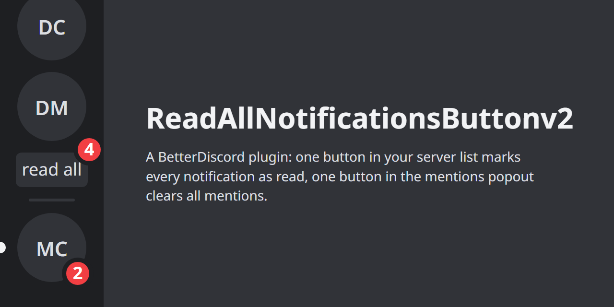
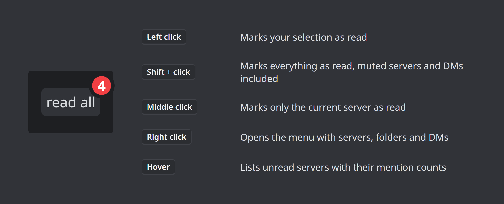
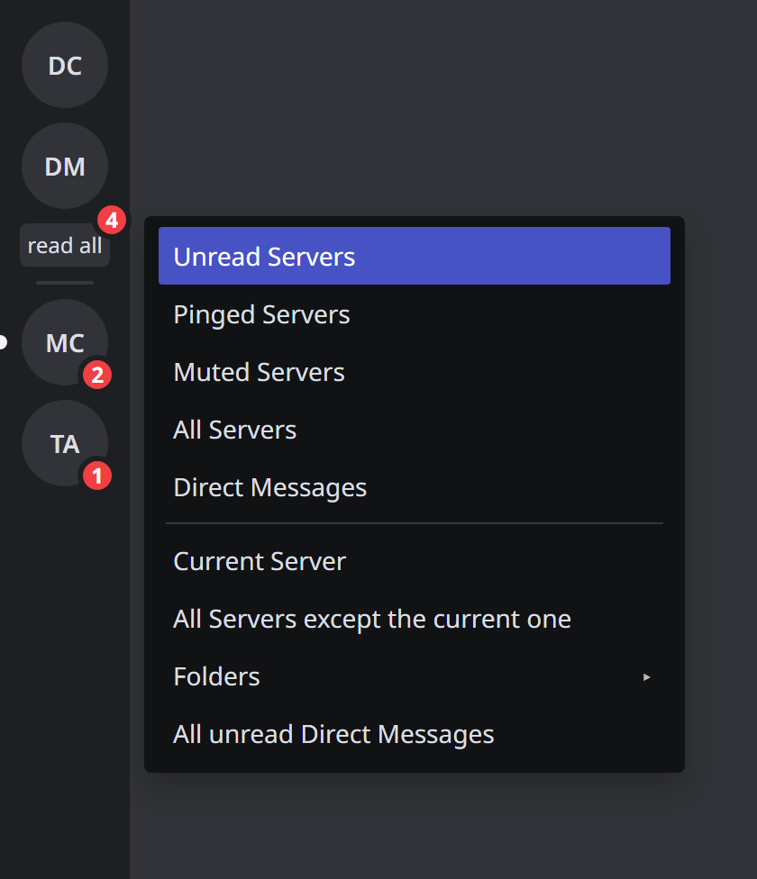
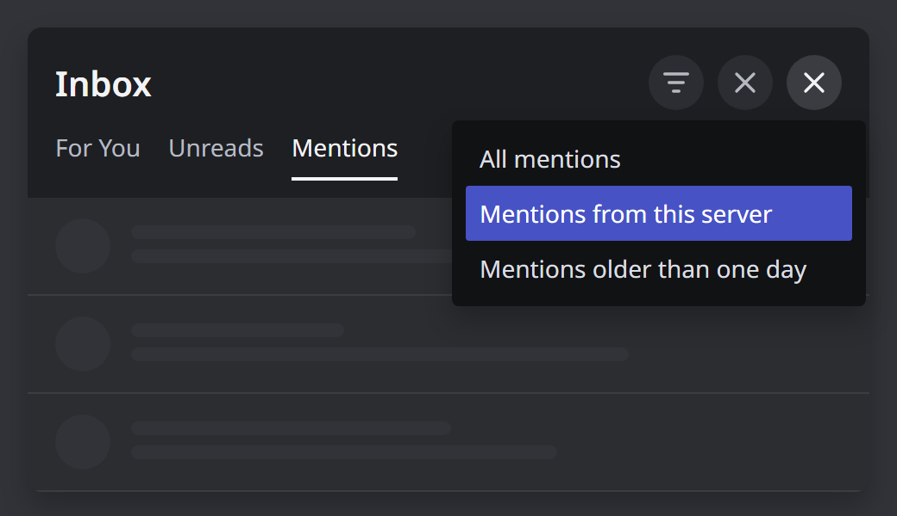

# ReadAllNotificationsButtonv2

A BetterDiscord plugin that adds a **read all** button to the server list and a button to the mentions popout that clears every recent mention. It works on its own, no library plugin needed.

Based on the idea of [ReadAllNotificationsButton](https://betterdiscord.app/plugins/ReadAllNotificationsButton) by DevilBro, written from scratch.

## Features

**Server list button**

- Left click marks your selection as read: unread servers, muted servers and direct messages with mentions (choose in the settings)
- Shift+click marks everything as read, including muted servers and all unread direct messages
- Middle click marks only the server you are currently in as read
- Uses Discord's own "Mark as Read" for servers, so channels, threads, forum posts, events and onboarding are covered
- Counter on the button: your mentions, or unread servers and direct messages, or off
- Button as text, as an icon or both
- Tooltip with the unread servers by name and their mention counts

**Right click menu on the button**

- Unread Servers, Pinged Servers, Muted Servers, All Servers, Direct Messages
- Current Server, All Servers except the current one
- Folders: every server folder that has something unread
- All unread Direct Messages

**Right click menu on a server, channel, category or thread**
- "Exclude from read all" puts it on the black list or takes it off again. An excluded category also covers its channels and their threads.

**Mentions popout**

- Close (All) button that removes every recent mention, one per second so Discord does not rate limit you
- Right click the button to clear only the mentions from the current server or the ones older than one day
- Optionally marks the channels of the cleared mentions as read

**Settings**
- Language: automatic (follows Discord) or one of the 30 languages below
- Only mark messages as read that are older than 1, 6 or 24 hours; newer messages and channels with mentions stay unread
- Keep channels with mentions unread
- Confirmation before marking or clearing: always, or only when it affects at least 5, 10 or 25 at once
- Server black list and the list of excluded channels
- Keybinds for the left click action and for clearing mentions (a keybind without Ctrl or Alt is ignored while you type)
- Mark your selection as read every 5, 15, 30 or 60 minutes
- Mark muted servers as read automatically, 5 seconds after a new message
- Mark everything as read when Discord starts
- Mark a server as read when you switch to another one
- Active hours: automatic reading only runs between two times you choose, also across midnight
- Statistics: how many servers and direct messages you marked as read and how many mentions you cleared
- Update check: a notice appears when a new version is out, one click installs it
- Custom button text, hide the button while nothing is unread, turn the result messages off

**Languages**

Bulgarian, Chinese (Simplified and Traditional), Croatian, Czech, Danish, Dutch, English, Finnish, French, German, Greek, Hindi, Hungarian, Indonesian, Italian, Japanese, Korean, Lithuanian, Norwegian, Polish, Portuguese (Brazil), Romanian, Russian, Spanish, Swedish, Thai, Turkish, Ukrainian, Vietnamese.

## Installation

1. Download [ReadAllNotificationsButtonv2.plugin.js](https://github.com/uwemanfred64-png/ReadAllNotificationsButtonv2/releases/latest/download/ReadAllNotificationsButtonv2.plugin.js) from the latest release
2. Put it into your BetterDiscord plugins folder (User Settings → Plugins → Open Plugins Folder)
3. Enable it in User Settings → Plugins

If you use the original ReadAllNotificationsButton, disable it first, otherwise you get two buttons.

From version 3.0.0 on the plugin updates itself: when a new version is out, a notice with an Update button appears.

## Privacy

The plugin only talks to Discord through Discord's own functions. The update check downloads the plugin file from this repository on GitHub (raw.githubusercontent.com) 10 seconds after start and every 6 hours. No data about you or your account is sent. You can turn the check off under Settings → Check for updates.

## Support

Questions, bug reports and ideas: [Discord server](https://discord.gg/bQeNQPHVcR) or [GitHub issues](https://github.com/uwemanfred64-png/ReadAllNotificationsButtonv2/issues).

## License

[MIT](LICENSE)
